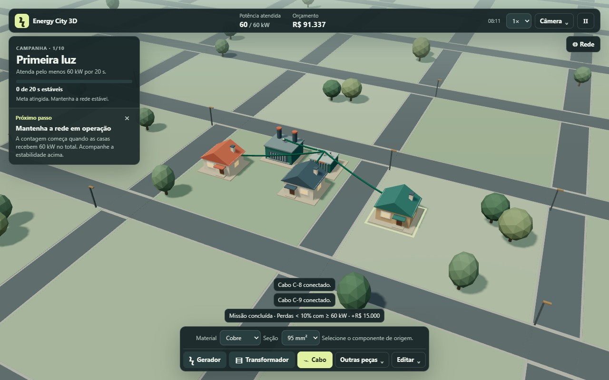

# ⚡ Rede Viva

**Um jogo para entender como a energia chega até a sua casa.**

Em **Rede Viva**, você é responsável pela rede elétrica de uma cidade em miniatura. Escolha onde instalar os geradores e transformadores, ligue a rede e veja as janelas do bairro acenderem. Conforme a cidade cresce, cada escolha de tensão, material e trajeto passa a pesar no orçamento e na estabilidade do fornecimento.

## Sua primeira rede

Na etapa **Primeira luz**, três casas de **110 V** esperam energia. Seu objetivo é atender **60 kW por 20 segundos de simulação**.

1. Escolha **Nova campanha** e instale um **gerador a gás** no lote sugerido.
2. Instale um **transformador de 110 V** perto das casas. Ele reduz a tensão da rede de **13,8 kV** para o valor usado no bairro.
3. Use a ferramenta **Cabo** para ligar o gerador ao transformador. O guia sugere cobre de **35 mm²** nesse trecho.
4. Ligue o transformador a **cada casa** com um ramal curto. O guia sugere cobre de **95 mm²** nessa primeira rede.
5. Acompanhe a barra de estabilidade. Ao completar a meta, a cidade recebe a próxima tarefa e você vê quantas estrelas ganhou.

O cartão **Próximo passo** indica onde construir ou o que conectar. Casas usam 110 V. Prédios e hospitais usam 220 V. As janelas iluminadas mostram onde a energia chegou.

## Por que a bitola do cabo importa?

Selecione a origem com a ferramenta **Cabo** e passe o ponteiro sobre o destino. A prévia mostra custo e resistência. Em ligações diretas entre transformador e imóvel, ela também estima corrente, queda de tensão e perda.

| Conta | O que ela explica |
| --- | --- |
| **R = ρ·L/A** | Um cabo mais longo ou mais fino oferece mais resistência. O material também faz diferença. |
| **I = P/U** | Para entregar a mesma potência, uma tensão mais baixa exige mais corrente. |
| **ΔV = R·I** | Parte da tensão se perde no caminho. O jogo exige que a tensão entregue fique dentro de ±10% da nominal. |
| **P = R·I²** | A perda por efeito Joule vira calor e aumenta com o quadrado da corrente. |

**Experimente comparar duas bitolas.** Uma casa de 20 kW a 110 V pede cerca de **182 A** pela conta nominal. Em um ramal de cobre de **22,4 m**, a prévia estima cerca de **0,36 kW** de perda com **35 mm²** e **0,13 kW** com **95 mm²**. No jogo, o primeiro cabo tem ampacidade de 125 A, então o desgaste acelera mesmo se a casa acender.

Se um cabo atingir **95 °C**, ele falha por calor. O **Post-Mortem** mostra o motivo da falha e as leituras do momento. Use o inspetor no painel **Rede** para acompanhar tensão, temperatura e integridade antes de chegar a esse ponto.

## Escolha como jogar

| Modo | O que você faz |
| --- | --- |
| **Campanha** | Desenvolva a mesma cidade em dez etapas, da primeira ligação a metas de eficiência, demanda e onda de calor. |
| **Desafio** | Com R$ 200.000, atenda toda a cidade por 20 s com demanda de pelo menos 150 kW. |
| **Sandbox** | Monte circuitos com orçamento livre, sem crescimento automático ou eventos. |

Na Campanha e no Desafio, a cidade pode ganhar um imóvel a cada marco de **40 s** se estiver totalmente atendida e houver lote livre. O jogo tem **três slots locais** e salva automaticamente a cada **5 s de simulação**. O menu de pausa reúne as opções de salvar e carregar.

## Controles essenciais

| Controle | Ação |
| --- | --- |
| **Clique no mapa** | Construir, conectar ou inspecionar conforme a ferramenta ativa na câmera orbital. |
| **Arrastar / roda do mouse** | Girar e aproximar a câmera orbital. |
| **Espaço / 1, 2, 3** | Pausar ou retomar / escolher a velocidade 1×, 2× ou 4×. |
| **V / P** | Alternar entre orbital, terceira e primeira pessoa / entrar no modo fotografia. |
| **WASD / Shift** | Caminhar / correr nas câmeras em primeira e terceira pessoa. |
| **Ctrl+Z / Ctrl+Y** | Desfazer / refazer operações de construção e edição. |
| **Esc** | Cancelar a ação ativa, fechar a janela ou pausar. |

## Para usar em sala

Peça à turma que energize as três casas. Em seguida, escolha um ramal e compare duas bitolas mantendo o material e os pontos de ligação. Antes de comprar, peça uma previsão sobre a queda de tensão, a perda e o desgaste. Depois, compare a prévia com as leituras no inspetor.

O **Codex** do menu tem circuitos prontos para experimentar queda de tensão, efeito Joule e cabos em paralelo. O [Guia do Jogador](docs/GUIA_DO_JOGADOR.md) detalha as peças, os controles e como recuperar uma rede após uma falha.

## Como rodar localmente

Com Node.js e npm instalados, rode na raiz do projeto.

~~~sh
npm ci
npm run dev
~~~

Abra o endereço mostrado pelo Vite, normalmente [localhost:5173](http://localhost:5173). O jogo requer WebGL. Partidas e preferências são salvas no navegador. Para gerar o site estático, use **npm run build**. A saída fica em **dist/** e pode ser conferida com **npm run preview**.

Para validar alterações, rode **npm run check** (tipos, lint e testes) e **npm run build**. Se mexer nas metas ou na economia, rode também **npm run balance:sim**.

## Por dentro do projeto

A aplicação usa React, TypeScript e Vite. Three.js, React Three Fiber e drei renderizam a maquete. Zustand guarda o estado, e Web Audio sintetiza a trilha e os efeitos.

| Área | Responsabilidade |
| --- | --- |
| [src/electrical](src/electrical) | Solver didático em corrente contínua, perdas e aquecimento. |
| [src/game](src/game) e [src/store](src/store) | Metas, economia, diagnóstico, ações do jogador e integração da simulação. |
| [src/data](src/data) | Balanceamento, preferências, slots e migrações. |
| [src/render](src/render), [src/ui](src/ui) e [src/i18n](src/i18n) | Cena, HUD e textos em pt-BR. |

Ao contribuir, siga as convenções de [AGENTS.md](AGENTS.md) e registre mudanças perceptíveis no [changelog](CHANGELOG.md). As referências de [balanceamento](docs/BALANCE.md), [arte](docs/ART.md), [assets](docs/ASSETS.md) e [desempenho](docs/PERF.md) dão mais detalhes para manutenção.
