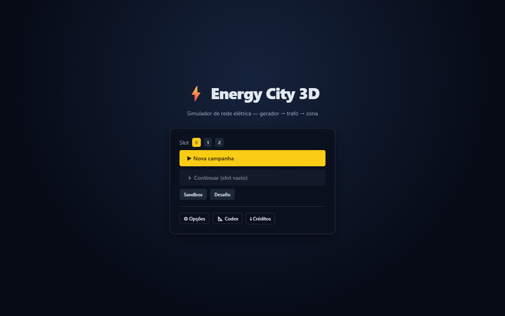
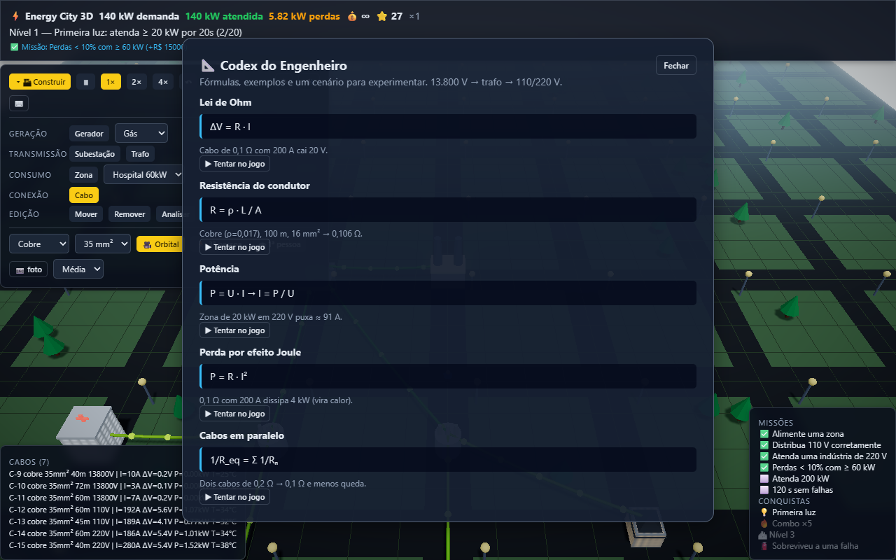

# ⚡ Energy City 3D

Simulador didático de rede elétrica em 3D. Construa **Gerador (13,8 kV) → Subestação → Trafo (110/220 V) → Casas, Prédios e Hospitais** e mantenha a cidade alimentada sem apagões — com física de verdade (queda de tensão, perdas por efeito Joule, aquecimento e falha de cabos).

As cargas têm personalidade: **Casa** (110 V, 20 kW), **Prédio** (220 V, 40 kW) e **Hospital** (220 V, 60 kW, crítico — sem energia pesa mais na economia e nas missões).


## Visão geral

- **Física fiel**: `R = ρ·L/A`, `I = P/U`, `ΔV = R·I`, `P = R·I²`. Cabo acima de 95 °C falha; zona fora de ±10% da tensão fica sem energia (roxa).
- **Solver nodal** (Kirchhoff/Gauss-Seidel) rodando em Web Worker; aceita malhas (cabos em paralelo) e vários geradores.
- **Campanha** com níveis 1–10 (metas de fornecimento, perdas e onda de calor), estrelas por desempenho, missões e conquistas.
- **Economia** coerente: receita, custo de perdas, penalidade por apagão, combustível e manutenção.
- **Cidade viva**: um bairro semente que você energiza, crescimento pelas ruas a partir do que já tem luz, e **continuidade** (`📶`) como medida de "manter a cidade acesa" (hospitais são críticos).
- **Post-Mortem didático**: cada falha abre um relatório com as contas passo a passo e como resolver.
- **Codex** com fórmulas, exemplos e cenários "tentar no jogo".

| Menu | Codex |
| --- | --- |
|  |  |

## Como jogar

A cidade já começa com um **bairro semente** (três casas sem energia). O nível 1 é energizá-lo; depois a cidade cresce quando você mantém tudo atendido.

1. Coloque um **Gerador** no chão livre perto do bairro (clique numa célula).
2. Coloque um **Transformador** de 110 V ao lado das casas.
3. Ligue os dois com um **Cabo** (ferramenta Cabo → clique origem → clique destino).
4. Coloque uma carga de mesma tensão do trafo (**Casa** 110 V, **Prédio**/ **Hospital** 220 V) e ligue-a com outro cabo.
5. Cumpra o objetivo do nível por alguns segundos para avançar.

O tutorial guiado aparece nos primeiros passos. Ferramentas ficam no painel esquerdo, agrupadas por categoria, com tooltips de custo/especificações.

### Atalhos

| Tecla | Ação |
| --- | --- |
| Espaço | Pausar / retomar |
| 1 / 2 / 3 | Velocidade 1× / 2× / 4× |
| V | Trocar câmera (orbital / 3ª / 1ª pessoa) |
| P | Modo fotografia |
| Ctrl+Z / Ctrl+Y | Desfazer / refazer |
| WASD + Shift | Mover / correr |
| Q / E | Girar câmera |
| Esc | Pausa |

## Como rodar

Requisitos: Node.js 20+ e npm.

```bash
npm install
npm run dev        # http://localhost:5173
```

### Scripts

| Comando | O que faz |
| --- | --- |
| `npm run dev` | Servidor de desenvolvimento |
| `npm run build` | Build de produção em `dist/` |
| `npm run preview` | Serve o `dist/` localmente |
| `npm test` | Testes (Vitest) |
| `npm run check` | Tipos + ESLint + testes (o que o CI roda) |
| `npm run balance:sim` | Simula os níveis 1–10 e imprime metas/orçamento |
| `npm run format` | Formata com Prettier |

## Arquitetura

```
src/
  electrical/   motor puro (R, I, P, solver nodal, térmico) + worker + cliente
  game/         regras puras: advance (economia/níveis/eventos), simulação de passo fixo, cenários
  data/         balanceamento, save versionado + migrações, telemetria local
  store/        zustand (estado, construção, economia, undo/redo)
  render/       React Three Fiber (Scene, Environment, Player, Effects, PostFX)
  audio/        WebAudio procedural com mixer
  ui/           telas, HUD, componentes, tokens (CSS Modules)
  i18n/         textos pt-BR
```

Fluxo do tick: laço de passo fixo (10 Hz) → `solve` no Web Worker → `advance` (puro) → store → React. A renderização interpola com um relógio visual contínuo e não depende de `setInterval`.

- Física e regras: `src/electrical/engine.ts` e `src/game/advance.ts` (funções puras, testáveis).
- Documentação: [`docs/BALANCE.md`](docs/BALANCE.md), [`docs/ART.md`](docs/ART.md), [`docs/ASSETS.md`](docs/ASSETS.md), [`docs/PERF.md`](docs/PERF.md), [`docs/BASELINE.md`](docs/BASELINE.md).

## Como contribuir

1. Crie uma branch e faça mudanças pequenas.
2. Rode `npm run check` (não pode quebrar tipos, lint ou testes) e `npm run build`.
3. Mantenha a física em funções puras (sem React/Three) e os textos da interface em `src/i18n`.
4. Dados de balanceamento ficam em `src/data/balance.ts` (nada de números mágicos).
5. Mudou o formato de save? Suba a versão e escreva a migração; save antigo nunca pode quebrar.
6. Descreva a mudança no `CHANGELOG.md` e, se for desempenho, atualize `docs/PERF.md`.

CI: GitHub Actions roda `npm run check` em pushes para `main` e pull requests (`.github/workflows/ci.yml`).

## Deploy

O build gera um site estático (`dist/`) — hospede em qualquer serviço (Vercel, Netlify, GitHub Pages, S3…). Não há backend; saves ficam no `localStorage` do navegador.

### Vercel (recomendado)

Já existe `vercel.json` configurado (`framework: vite`, `npm run build`, `dist`).

**Via painel:**
1. Suba o projeto para o GitHub.
2. Em [vercel.com/new](https://vercel.com/new), importe o repositório.
3. A Vercel detecta Vite; confirme Build Command `npm run build` e Output `dist`.
4. Deploy. Cada push gera uma nova URL de preview; `main` publica em produção.

**Via CLI:**
```bash
npm i -g vercel
vercel          # primeira vez: login e vínculo do projeto (preview)
vercel --prod   # produção
```

### Teste local do build

```bash
npm run build
npm run preview   # http://localhost:4173
```

### Outras opções

- **Netlify**: Build `npm run build`, publish `dist`.
- **GitHub Pages**: defina `base: '/<repo>/'` no `vite.config.ts`, rode o build e publique `dist` (ex.: com `gh-pages`).
