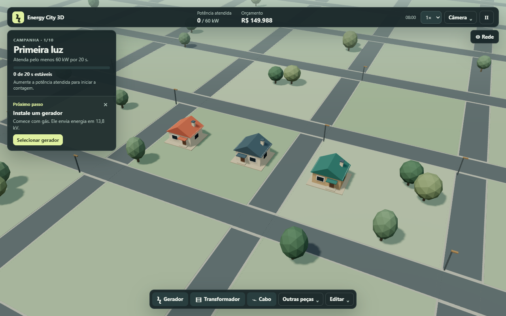

# ⚡ Energy City 3D

### Um jogo para entender como a energia chega até a sua casa.

**Energy City 3D** é um simulador de rede elétrica em 3D. O jogador é o engenheiro da cidade: precisa levar energia do gerador até casas, prédios e hospitais, escolhendo cabos, transformadores e rotas — e lidando com as consequências reais de cada decisão.


> **Para a turma:** em 5 minutos, você constrói uma rede, acende três casas e descobre por que um cabo pode pegar fogo.

> **Quer o manual completo?** Veja o [Guia do Jogador](docs/GUIA_DO_JOGADOR.md). Este README é a apresentação rápida.

---

## O jogo em 3 frases

1. A cidade precisa de energia; você projeta a rede que leva essa energia até cada casa.
2. Cada cabo tem comprimento, material e espessura; cada equipamento tem um limite de potência.
3. A física é de verdade: cabo fino ou longo esquenta, perde energia e pode queimar. O jogo mostra a conta.

**Objetivo:** atender a demanda da cidade, dentro do orçamento, sem apagões, pelo tempo pedido em cada nível.

---

## Como se joga

No nível 1, três casas de **110 V** esperam energia. A meta é atender **60 kW por 20 segundos**.

1. **Gerador** no chão livre, perto das casas.
2. **Trafo de 110 V** ao lado das casas.
3. **Cabo** ligando o gerador ao trafo.
4. **Cabo** ligando o trafo a cada casa.
5. Espere o objetivo completar 20 segundos e veja as estrelas.



**A regra de ouro:** `gerador → (subestação opcional) → trafo → zona`.

- A tensão do trafo precisa casar com a da zona: **110 V** para casas, **220 V** para prédios e hospitais.
- Se a tensão estiver errada, a casa fica **roxa**.
- Se a tensão cair mais de **10%**, a zona não liga.
- Se o cabo passar de **95 °C**, ele queima e vira fogo.

### O que acontece quando algo dá errado

O jogo abre um **Post-Mortem**: corrente, resistência, queda de tensão, perda, temperatura e uma lista de soluções. A ideia não é punir — é mostrar **por que** falhou.

---

## Por que ele é diferente de um jogo comum

| O jogo mostra | O que isso significa na prática                                        |
| ------------- | ---------------------------------------------------------------------- |
| `R = ρ·L/A`   | Cabo mais longo ou mais fino tem mais resistência.                     |
| `I = P/U`     | Tensão menor exige corrente muito maior.                               |
| `P = R·I²`    | A perda cresce com o quadrado da corrente e vira calor.                |
| `ΔV = R·I`    | A tensão cai ao longo do cabo; acima de 10% de queda, a zona não liga. |

**Exemplo real do jogo:** uma casa de 20 kW em 110 V puxa **≈ 182 A**. Com um cabo de cobre de 35 mm² e 100 m, a queda é de **≈ 8,8 V (8%)** e a perda é de **≈ 1,6 kW**. A casa ainda liga, mas o cabo chega a **≈ 105 °C** e vai falhar. A solução: encurtar o trecho, aumentar a seção ou dividir a carga.

É por isso que a energia é transmitida em **13,8 kV** e só é abaixada perto de quem consome: alta tensão significa menos corrente e muito menos perda.

---

## As peças do jogo

| Peça              | O que faz                                                                                  |
| ----------------- | ------------------------------------------------------------------------------------------ |
| **Gerador**       | Produz em 13,8 kV. Pode ser a gás (500 kW), hídrico (900 kW) ou solar (200 kW, só de dia). |
| **Subestação**    | Concentra a alta tensão, tem capacidade de 300 kW e 1% de perda. É opcional.               |
| **Transformador** | Recebe 13,8 kV e entrega 110 V ou 220 V. Capacidade de 150 kW.                             |
| **Cabo**          | Cobre ou alumínio, de 16 a 95 mm². Tem resistência, corrente, perda e temperatura.         |
| **Zona**          | Casa (110 V, 20 kW), prédio (220 V, 40 kW) ou hospital (220 V, 60 kW, crítico).            |

---

## A tela em 1 minuto

- **Barra superior:** demanda, energia atendida, perdas, orçamento, continuidade, relógio, nível e evento ativo.
- **Painel esquerdo:** ferramentas de geração, transmissão, consumo, conexão e edição.
- **Lista de cabos:** corrente, queda, perda e temperatura de cada trecho.
- **Inspetor:** ao selecionar um componente, mostra os números e o estado.
- **Missões e tutorial:** objetivos extras e os primeiros passos guiados.

**Cores:** roxo = tensão errada · vermelho = componente falhado · amarelo = perto do limite · fogo/faísca = cabo superaquecendo.

---

## Modos de jogo

| Modo         | Proposta                                                                     |
| ------------ | ---------------------------------------------------------------------------- |
| **Campanha** | 10 níveis, de 60 kW a 400 kW. Estrelas conforme o orçamento que sobra.       |
| **Desafio**  | Chegar a 150 kW de demanda e manter tudo atendido por 20 s com R$ 200.000.   |
| **Sandbox**  | Dinheiro infinito e sem eventos, para testar layouts e aprender sem pressão. |

A cidade **cresce sozinha** quando você a mantém 100% atendida. A cada 40 s surge uma nova casa, prédio ou hospital. Depois de 60 s começam os eventos: pico de consumo (+50%), tempestade (+30% de resistência), queda de gerador e onda de calor (+20%).

O jogo tem **3 slots de save** e **autosave a cada 5 segundos de jogo** no navegador.

---

## Controles essenciais

| Tecla               | Ação                                   |
| ------------------- | -------------------------------------- |
| **Clique**          | Construir, selecionar ou conectar cabo |
| **Arrastar / roda** | Girar e dar zoom na câmera orbital     |
| **Espaço**          | Pausar / retomar                       |
| **1 / 2 / 3**       | Velocidade 1× / 2× / 4×                |
| **V**               | Câmera orbital / 3ª pessoa / 1ª pessoa |
| **P**               | Modo fotografia                        |
| **Ctrl+Z / Ctrl+Y** | Desfazer / refazer                     |
| **Esc**             | Fechar janela ou pausar                |

> A construção só funciona no modo **Orbital**.

---

## Para o professor

**O que a turma aprende jogando:**

- por que a transmissão em alta tensão reduz perdas;
- relação entre potência, tensão e corrente;
- resistência em função de material, comprimento e seção;
- efeito Joule, aquecimento e falha de condutores;
- queda de tensão e tolerância de ±10%;
- sobrecarga de transformadores e geradores;
- diagnóstico de falhas com contas reais.

**Ficha técnica:**

| Item          | Detalhe                                                                                                                          |
| ------------- | -------------------------------------------------------------------------------------------------------------------------------- |
| Stack         | React 18, TypeScript, Vite, three.js / React Three Fiber, zustand                                                                |
| Física        | Funções puras em [`src/electrical/engine.ts`](src/electrical/engine.ts), sem React ou Three                                      |
| Regras        | Economia, níveis, eventos e missões em [`src/game/advance.ts`](src/game/advance.ts)                                              |
| Balanceamento | Todos os números em [`src/data/balance.ts`](src/data/balance.ts)                                                                 |
| Qualidade     | **49 testes** passando, ESLint, TypeScript estrito e CI no GitHub Actions                                                        |
| Distribuição  | Site estático, sem backend; saves no `localStorage`                                                                              |
| Documentação  | [Guia completo](docs/GUIA_DO_JOGADOR.md), [balanceamento](docs/BALANCE.md), [assets](docs/ASSETS.md), [desempenho](docs/PERF.md) |

**Para rodar na sala:**

```bash
npm install
npm run dev        # http://localhost:5173
```

Para validar o projeto:

```bash
npm run check      # tipos + lint + testes
npm run build      # build de produção
```

---

## Roteiro de apresentação (5 minutos)

| Tempo     | O que falar                                                               | O que mostrar                                  |
| --------- | ------------------------------------------------------------------------- | ---------------------------------------------- |
| 0:00–0:30 | “Você já pensou quanta energia se perde no caminho até a sua casa?”       | Tela inicial e a cidade                        |
| 0:30–1:30 | “Vou construir uma rede mínima: gerador, trafo e três casas.”             | Nova campanha → gerador → trafo 110 V → cabos  |
| 1:30–2:30 | “Cada cabo tem uma conta: R, corrente, queda e perda.”                    | Clicar no cabo e abrir o inspetor              |
| 2:30–3:30 | “Se eu usar um cabo longo e fino, ele esquenta. O jogo explica o porquê.” | Post-Mortem de uma falha (pode ser no sandbox) |
| 3:30–4:30 | “A cidade cresce, os eventos apertam e o orçamento cobra escolhas.”       | HUD, missões e níveis                          |
| 4:30–5:00 | “O jogo ensina física enquanto você joga.”                                | Tela de conclusão e estrelas                   |

### Perguntas para a turma

1. Por que a rede usa **13,8 kV** em vez de 220 V na rua toda?
2. Por que um cabo comprido esquenta mais que um cabo curto?
3. O que acontece se uma casa de 110 V for ligada em um trafo de 220 V?
4. Por que dois cabos em paralelo reduzem a perda?
5. O que você faria para atender um hospital sem deixar as casas no escuro?

---

## O que já está pronto e o que falta

**Pronto:** construção, física, solver nodal, campanha de 10 níveis, três modos, economia, eventos, Post-Mortem, Codex, tutorial, saves e áudio procedural.

**Próximos passos:** reparo/remoção direta de cabos, save manual na interface, final de campanha, ajuste fino dos níveis de onda de calor e suporte a celular.

> O [Guia do Jogador](docs/GUIA_DO_JOGADOR.md) detalha cada peça, cada grandeza, a economia, os eventos, as missões e as limitações conhecidas.
