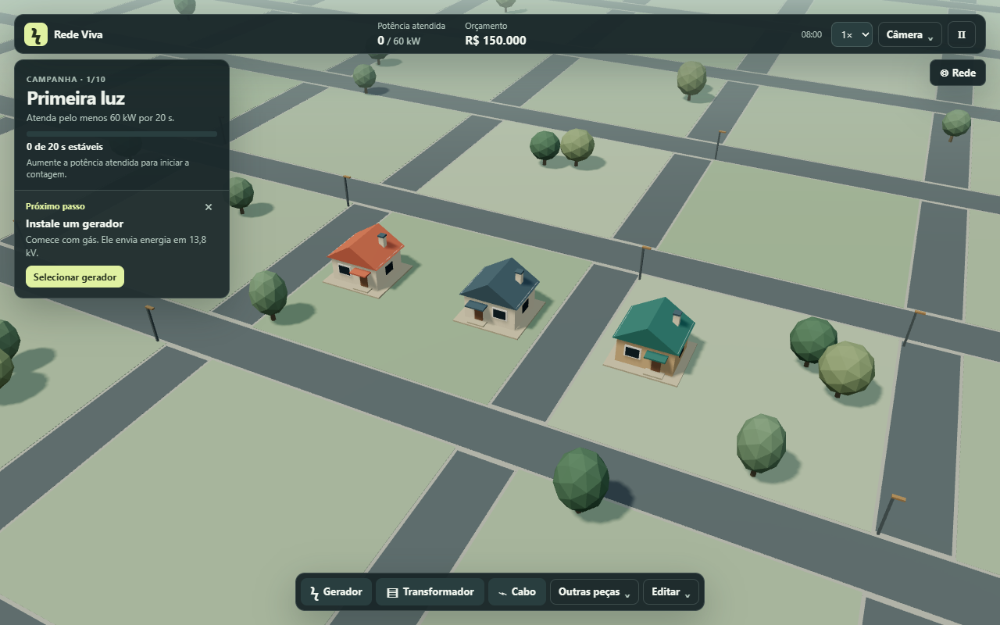
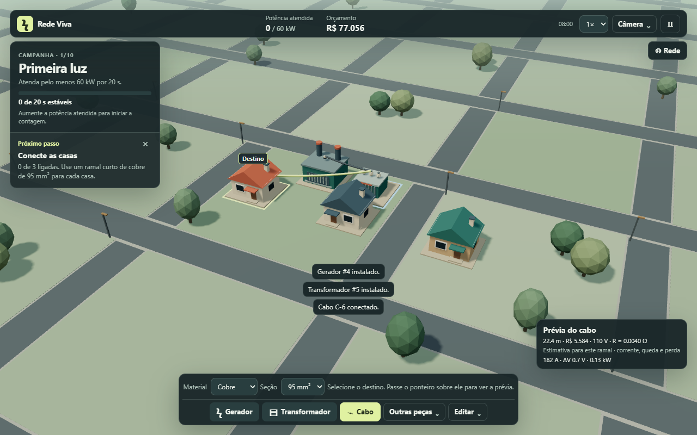

# Guia do jogador

## Primeira luz

Escolha **Nova campanha** e siga o cartão **Próximo passo**. Você pode ocultá-lo e reabrir a orientação a qualquer momento.

1. Escolha um **gerador a gás** e instale-o no lote destacado. Ele fornece energia a **13,8 kV** depois da partida.
2. Instale um **transformador de 110 V** perto das casas. Ele abaixa a tensão para o valor usado no bairro.
3. Selecione **Cabo**. Clique no gerador e depois no transformador. A orientação pode preparar a origem e a seção para você.
4. Ligue o transformador a **cada** casa. Use ramais curtos. Na primeira rede, a orientação sugere cobre de **35 mm²** na alta tensão e **95 mm²** nos ramais de 110 V.
5. Mantenha **60 kW** por **20 s de simulação**. As janelas acendem quando as casas recebem energia. A tela de promoção mostra as estrelas, o aporte e a próxima meta.

## O que a tela mostra

- **Barra superior** — potência atendida sobre demanda, saldo, relógio, velocidade, câmera e pausa.
- **Cartão de etapa** — meta, tempo de estabilidade e orientação de construção ou diagnóstico. Na expansão, a orientação aponta a tensão do próximo imóvel e sugere o transformador ou o cabo.
- **Barra inferior** — Gerador, Transformador e Cabo. Abra **Outras peças** para construir imóveis e subestações. Abra **Editar** para inspecionar, mover, demolir, desfazer, refazer ou alternar a manutenção.
- **Rede** — inspetor, lista de cabos, missões, conquistas, perdas e continuidade. Clique num objeto no modo de inspeção para ver os detalhes. O inspetor mostra temperatura, integridade e os números usados nas contas.
- **Mapa** — o destaque indica onde construir ou qual peça conectar. As janelas iluminadas mostram atendimento. Roxo e o rótulo de tensão indicam incompatibilidade ou tensão fora da faixa. Âmbar avisa sobre limite de carga ou calor.

## Escolha os componentes

| Componente | Função |
| --- | --- |
| **Gerador** | Fonte de 13,8 kV. Gás fornece até 500 kW, hídrica até 900 kW e solar até 200 kW durante o dia. |
| **Subestação** | Distribuição opcional em alta tensão. Capacidade de 300 kW e perda própria de 1%. |
| **Transformador** | Reduz 13,8 kV para **110 V** ou **220 V**. Capacidade de 150 kW. |
| **Imóvel** | Casa de 20 kW a 110 V, prédio de 40 kW a 220 V ou hospital crítico de 60 kW a 220 V. |
| **Cabo** | Cobre ou alumínio, com seção de 16 a 95 mm². O custo cresce com o comprimento e a seção. |

### Antes de ligar um cabo

Escolha o material e a seção. Selecione a origem e passe o ponteiro sobre o destino. A prévia mostra o custo e a resistência. Num trecho direto entre transformador e imóvel, também estima corrente, queda de tensão e perda pela carga nominal. Confira as medições no inspetor depois de instalar.

Em uma casa de 20 kW a 110 V, a estimativa é **182 A**. Num trecho de cerca de 22,4 m de cobre de 95 mm², **R = ρ·L/A ≈ 0,004 Ω**, a queda **ΔV = R·I ≈ 0,73 V** e a perda **P = R·I² ≈ 0,13 kW**. A ampacidade de 95 mm² é 232 A no jogo. Um cabo de 35 mm² tem ampacidade de 125 A e se desgasta rapidamente nessa mesma casa, mesmo que a tensão entregue ainda esteja dentro da tolerância.

### Quando algo falha

| Sintoma | O que conferir |
| --- | --- |
| **Imóvel escuro** | Confira a partida do gerador e o caminho até o lado de baixa tensão do transformador. Solar fica offline à noite. |
| **Imóvel roxo** | Confira a tensão nominal. Use 110 V para casas e 220 V para prédios ou hospitais. Se a tensão estiver correta, encurte o ramal ou aumente a seção para reduzir a queda. |
| **Cabo quente ou sem integridade** | Reduza a corrente por ramal, use cobre ou seção maior e encurte o percurso. A temperatura limite é 95 °C. |
| **Equipamento perto da capacidade** | Distribua a carga entre equipamentos ou instale mais geração, conforme o componente apontado pelo inspetor. |

O **Post-Mortem** explica a falha com os valores do momento. O reparo custa **25%** do valor original do componente. A remoção reembolsa **50%**. Reparar restaura o componente, mas a causa pode voltar se o circuito continuar subdimensionado. O **Codex** tem exemplos com circuitos de queda de tensão, efeito Joule e cabos em paralelo.

[Veja a tela do Codex](screenshots/codex.png).

## Continue a partida

- **Campanha** — avance por dez etapas preservando a rede. O contador reinicia se a meta deixar de valer ou houver falha. Estrelas refletem o saldo ao concluir a etapa. O aporte completa a diferença até o piso de orçamento da próxima etapa. Após a etapa 10, a gestão da mesma cidade segue livre.
- **Expansão** — a cada marca de 40 s, a cidade pode ganhar um imóvel se estiver totalmente atendida e houver lote livre. Você também pode construir imóveis para aumentar a demanda.
- **Eventos** — pico de consumo, tempestade e religamento de gerador podem ocorrer na Campanha e no Desafio. A campanha também tem ondas de calor de +20% de demanda. O primeiro intervalo de calor é de 90 a 110 s de simulação.
- **Partidas** — há três slots locais. O autosave roda a cada 5 s de simulação, na promoção e ao sair da aba. Na pausa, use os botões de salvar, carregar e salvar e sair. Cenários do Codex são temporários até que você escolha salvá-los.

## Controles

| Controle | Ação |
| --- | --- |
| Clique no mapa | Construir ou interagir, conforme a ferramenta ativa na câmera orbital. |
| Arrastar e usar a roda | Girar a câmera orbital e aproximar ou afastar. |
| Espaço | Pausar ou retomar. |
| 1 / 2 / 3 | Velocidade 1×, 2× ou 4×. |
| V / P | Alternar câmera ou entrar no modo fotografia. |
| WASD, Shift e Q/E | Caminhar, correr e girar nas câmeras em primeira e terceira pessoa. |
| Ctrl+Z / Ctrl+Y | Desfazer ou refazer operações de construção e edição. |
| Esc | Cancelar a ferramenta ativa, fechar uma janela ou pausar. |

Consulte [Balanceamento](BALANCE.md) para os parâmetros e as limitações do modelo elétrico didático.
