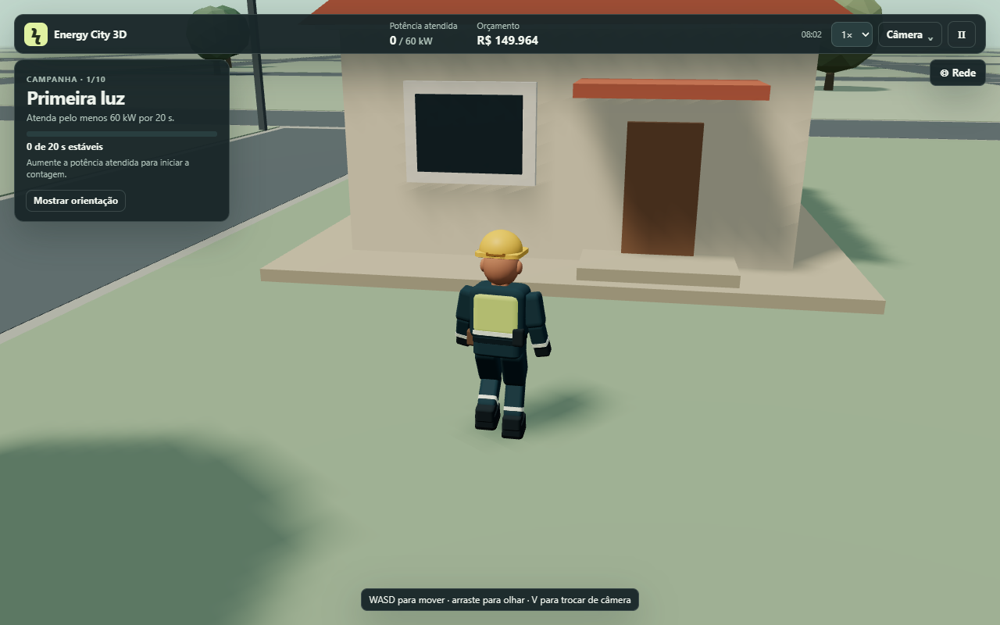

# Pipeline de modelos

## Peças da maquete

Edite as receitas em [districtParts.ts](../src/render/districtParts.ts) e as cores do ambiente em [art.ts](../src/render/art.ts). Mantenha a base em Y=0, deixe espaço entre lotes vizinhos de 10 unidades e confira a altura do ponto de ligação antes de alterar telhados ou isoladores.

Os grupos de geometria têm funções distintas. A base recebe sombra e a estrutura projeta sombra. As janelas usam emissão separada para refletir atendimento e tensão inválida. Ao adicionar uma variação, confira o modelo energizado, desligado e incompatível. Veja a [direção de arte](ART.md).

## Eletricista

O [avatar](../src/render/Avatar.tsx) tem cerca de duas unidades de altura. O [ciclo de passada](../src/render/gait.ts) avança com o deslocamento real. Durante o apoio, as juntas do quadril e joelho mantêm o pé no ponto de contato. Confira partida, parada, corrida, marcha lateral e aproximação de paredes ao alterar o ciclo.

## Protótipos GLB

Os GLBs em **public/models** são referências de autoria, incluindo **player.glb**. A maquete e o eletricista jogável são definidos no código. Gere os protótipos em uma pasta separada para conferir escala, materiais e posição.

~~~sh
blender -b -P tools/blender/character.py -- arte-exportada
blender -b -P tools/blender/equipment.py -- arte-exportada
~~~

O conversor de OBJ incorpora texturas quando encontra os materiais e usa as regras de nome e de textura do projeto. Use **--no-draco** se quiser um GLB sem Draco.

~~~sh
npm run models:convert -- assets-src/OBJ arte-exportada --no-draco
npm run assets:check -- arte-exportada
~~~
